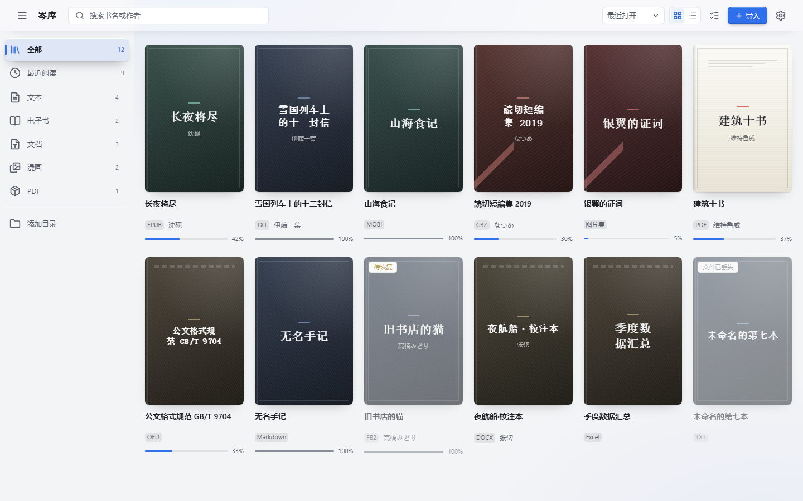
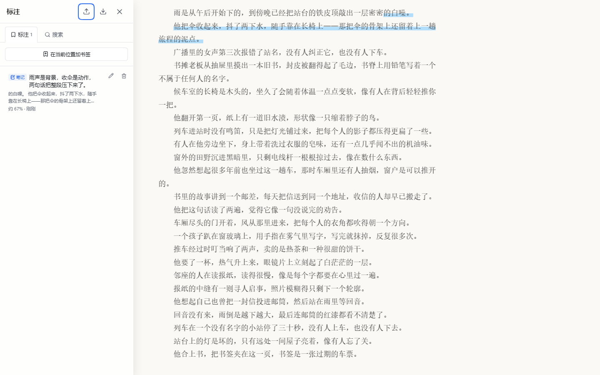

# 岑序 · Cenro


不联网、不要账号、不推书。书是你的文件，阅读记录是本机的一个 SQLite 文件。

**v1.0.1**（2026-11-19）· Windows 与 Android 都有可安装构建 · [GPL-3.0-or-later](LICENSE) · Tauri 2 + React 19



<p align="center"><sub>书架：网格视图。示例数据由本地开发用的假后端提供，不是真实书目。</sub></p>

---

## 为什么会有它

市面上的阅读器大多绑定书源、绑定账号、绑定同步。我只想要一件事：
**把手里的文件读掉，并且记住我读到哪里**。所以岑序的取舍是：

| | |
|---|---|
| 只管本地文件 | 没有在线书源，也不打算有；书从磁盘进，读完还在磁盘上 |
| 格式统一 | 小说 / 漫画 / 文档三类共用一个书架，一本书只归一个分类 |
| 痕迹留得下 | 书签、划线、笔记、标签都存本机，能导出，也能导回来 |

## 界面



<p align="center"><sub>阅读页与标注面板：划词写笔记，右侧按类型筛选。</sub></p>

## 能读什么

| 类型 | 格式 |
|---|---|
| 小说 | `.txt` `.html` `.htm` `.xhtml` `.epub` `.mobi` `.prc` `.azw3` `.azw` `.fb2`；`.md` / `.markdown`（富文本，只滚动不分页） |
| 漫画 | `.cbz` `.cbr` `.cbt` `.cb7`、内含 ≥ 3 张图的 `.zip`、同层 ≥ 3 张图的文件夹、图片型 `.mobi` |
| 文档 | `.pdf`、`.ofd`（逐页 SVG）、`.docx` / `.rtf` / `.mhtml` / `.mht`、`.xlsx` |

MOBI 与 ZIP 按内容判定：图片记录 ≥ 3 条走漫画阅读器，否则按文字书处理。
**不支持**：带 DRM 的文件、KF8 分片重排的 AZW3、`.doc` / `.ppt` / `.pptx` / `.xls`、CHM / DjVu。

## 书架

- 网格 / 列表双视图；无封面的书按书名生成文字封面（色相由书名哈希，同一本书恒定）
- 按格式族分类（全部 / 最近阅读 / 文本 / 电子书 / 文档 / 漫画 / PDF）、按标题与作者搜索、三种排序
- **标签**：与分类正交的另一根轴。分类由格式决定，一本书只能落一格；标签自己贴，
  侧栏可按标签筛，且能与分类叠加（「漫画 + 待读」）
- 右键菜单（移动端长按）：打开 / 显示文件夹 / 编辑信息 / 标签 / 移除 / 删除；桌面端 `Shift+F10` 同样可用
- **批量**：多选后可移入隐私书架、或**复制**到指定文件夹（同名自动加 `(1)`，不覆盖）
- 拖文件或文件夹到窗口任意位置即可导入；已导入的书再拖一次不会重复入库
- 缓存统计与清理、封面批量重建、阅读统计（在架 / 在读 / 已读完 / 分类分布 / 近 7 天）

## 阅读

六个阅读视图，共用一套工具栏、进度与快捷键语义：

| 视图 | 覆盖 |
|---|---|
| 文本 | TXT · MOBI · AZW3 · FB2 · Markdown · DOCX · RTF · MHTML |
| 富文本 | HTML · XHTML |
| 电子书 | EPUB |
| 版式 | PDF（pdf.js）· OFD |
| 漫画 | CBZ · CBR · CBT · CB7 · ZIP · 图片文件夹 |

- 分页（CSS 多栏 + 实测列宽）与连续滚动两种模式，进度以同一套坐标落库，退出重进回到原处
- EPUB 章节内链接跳转；**脚注就地弹窗**——点数字标记，注释浮在旁边，不再「跳走再找回来」
- PDF：单双页、连续滚动、缩放、目录树、文字层搜索
- 漫画：日漫 / 西漫方向、单双页、条漫模式
- 每个阅读页内置快捷键说明（顶栏 `?`），只列当前格式真实可用的键位

## 标注

- **书签**：覆盖全部格式，可重命名、按位置 / 时间排序、同位置去重、删除后 6 秒内撤销
- **划词高亮与笔记**：选中正文即浮出「高亮 / 笔记」，覆盖 **TXT / HTML / EPUB / PDF**。
  锚点存「章内字符区间」，改字号、行高、字体、分页或滚动都不会漂；
  绘制前用原文校验，书换了内容就宁可不画，不会把线画到别的句子上；
  PDF 存的是「页码 + 归一化矩形」，缩放、改窗口、切单双页都不会画偏（扫描件没有文本层，选不了字）
- 面板按类型筛选（全部 / 书签 / 高亮 / 笔记），点一条**精确翻到划线所在页**；点正文里的划线可回看笔记
- **导出** Markdown / CSV / JSON：前者给人看（引用块 = 书里原话，正文段 = 你写的），
  JSON 存的是库里的原值，可以**导回来**；导入按「类型 + 位置 + 锚点 + 备注 + 原文」去重

## 搜索

- 书内全文搜索覆盖 **12 种格式**，命中带章节名与上下文，点击跳转
- PDF 走 pdf.js 的文字层：逐页抽文本、压缩空白、全角转半角后匹配，按页缓存，200 条上限
- 扫描件 PDF 与漫画没有文字层，面板会如实说明原因，而不是回一个空结果

## 隐私书架

- 六位 PIN（Argon2id 哈希），可设自动上锁时间；书架标题长按 0.8 秒进入
- 锁定时，隐私书不出现在书架、搜索、排序、分类计数与统计里；封面挪出公开目录
- 备份默认**不含**隐私书的标注与备注
- **只做可见性隔离，不加密文件**：挡住的是「别人拿起设备翻两下」，不是取证

## 备份与迁移

- 本地 zip 备份（可「快速备份」到应用数据目录），WebDAV 上传 / 列出 / 恢复 / 删除，超出份数自动清理
- 恢复只覆盖数据库与封面，**不动书籍文件**；换机后封面路径按 `<book_id>.jpg` 自动重指
- 标注另有一条独立通道：导出 JSON → 在另一台机器导入同一本书

## 界面

- 暗色 / 亮色双主题跟随系统；阅读区可独立选浅色 / 深色 / 护眼 / 纯黑四套纸面
- 可选「液态玻璃」材质，与主题正交；书架背景图支持填充 / 不透明度 / 模糊 / 纸色遮罩，
  并从图里取主色派生强调色（按亮暗各自实算对比度）
- 连续曲率圆角（`corner-shape: squircle`，不支持的环境回退普通圆角）
- **自定义字体**（桌面端）：中文与西文各选一个字体文件，西文排在字体栈首、汉字落到中文字体
- 无障碍：`F6` 在顶栏与底栏间循环焦点、翻页位置经 `aria-live` 播报、移动端返回键按层级逐级返回

## 安装

到 [**Releases**](https://github.com/Lumivox-wiz/Cenro/releases/latest) 下载：

| 平台 | 文件 | 说明 |
|---|---|---|
| Windows | `Cenro_<版本>_x64-setup.exe` | 装到当前用户目录，不需要管理员 |
| Windows | `Cenro-<版本>-win-x64-portable.exe` | 免安装 |
| Android | `Cenro-<版本>-android-arm64.apk` | 只含 arm64-v8a |

国内访问 GitHub 不稳时，用 Gitee 镜像：[gitee.com/Lumivox/cenro](https://gitee.com/Lumivox/cenro)
——代码、标签与**安装包**都有（[发行版](https://gitee.com/Lumivox/cenro/releases)）。

没有上架任何应用商店。Windows 需要 WebView2（Win11 自带；Win10 缺失时装一次
[Evergreen Runtime](https://go.microsoft.com/fwlink/p/?LinkId=2124703)）。
首次启动会在书架里放一本《岑序使用说明》，讲完导入、阅读、标注、搜索、隐私与排错，删掉不再回来。

## 从源码构建

需要 Node 20.19+、Rust 1.85+（edition 2024）；Windows 还需 MSVC 构建工具与 WebView2。

```bash
npm install
npm run tauri dev
```

检查：

```bash
npx tsc --noEmit                 # 前端类型
npm run build                    # 前端产物（会先跑 prebuild 同步 pdf.js 资源）
cd src-tauri && cargo test       # Rust 单测（125 项）

npm run dev                      # 另开一个终端
npm run smoke                    # 用浏览器把八种阅读器与主要交互跑一遍
```

`npm run smoke` 由 `scripts/smoke.mjs` 驱动无头 Edge，连 `localhost:1420` 的开发用假后端，
逐项断言：书架 → TXT / MD / DOCX / XLSX / EPUB / PDF / OFD / 漫画八种阅读器 → 书签与划词 →
标签 → 批量条 → 设置八页。任何一项失败退出码为 1。它替代的是「改一行公共代码就把每个格式点一遍」。

打包：

```bash
npm run tauri build -- --bundles nsis     # Windows 安装包
bash scripts/build-android.sh             # Android（JDK 17 + SDK 36 + NDK 27）
```

> `cargo build --release` **不会嵌入 `dist/`**，程序会去连 devUrl，表现为窗口一片黑。
> 验证必须走 `npm run tauri build`。Android 脚本中间那步「同步 assets」也不能省，
> `npx tauri android build` 不会把新的前端产物写进 `gen/android/app/src/main/assets`。

## 数据放在哪

Windows：`%APPDATA%\com.lumivox.cenro\`；Android：应用私有目录（卸载即删）。

| 路径 | 内容 |
|---|---|
| `cenro.db` | 书籍、书库根、进度、标注、标签（WAL 模式） |
| `covers/` · `private_covers/` | 封面缩略图（后者是隐私书，从前者挪出来） |
| `comic_cache/` · `epub_cache/` | 按需解压的页与章节资源，启动时按 LRU 裁剪到 1.5 GB 内 |
| `inbox/` · `books/` · `incoming/` | 导入与「用其他应用打开」进来的副本 |
| `backups/` · `backup.json` | 本地备份包；WebDAV 配置（密码明文，Unix 上权限 600） |
| `privacy.json` · `manual/` · `logs/` | PIN 配置、随包说明副本、运行日志（2 MB 轮转） |

## 兼容性

| 平台 | 要求 | 说明 |
|---|---|---|
| Windows | 10 1803+（64 位） | 需要 WebView2 **109+**；缺了自动下载，低于 109 安装程序会先拉起更新 |
| Android | 8.0+（API 26） | 只出 `arm64-v8a`；x86 模拟器装不上。**WebView 需要 Chrome 100+**，太旧的应用会自己换成一块原生说明页（见下） |
| macOS / Linux | 未验证 | CI 配了工作流但没跑过，也没有签名与公证 |

**老内核的降级策略**（WebView2 跟着系统走，有的机器停在 109 / 2023-01）：

- 构建目标钉在 `chrome100`，语法层面保守；
- pdf.js v6 在模块顶层会碰 `Iterator` 与 `Promise.withResolvers`，两个都在
  `src/lib/polyfills.ts` 里补了，否则入口 chunk 直接抛错、窗口一片黑；
- CSS 新特性都带兜底：`corner-shape` 包在 `@supports` 里，`color-mix()` 前面先给一版
  普通颜色（老内核丢掉后一行不影响观感），`text-wrap: balance` 不支持时退回正常折行；
- 真跑不起来时窗口不是纯黑：`index.html` 里有一块静态占位，会把错误印在窗口上；
  8 秒内前端没有任何消息，Rust 侧把可能原因写进日志。

**安卓旧 WebView 不会黑屏给你看**：启动时读系统 WebView 的 Chrome 主版本，低于 100 就
换上一块原生说明页（不是 WebView 渲染的，一定能画出来），上面写着「去应用商店更新 Android
System WebView」，并带一个按钮直达商店详情页。读不到版本号时放行——宁可让它在能看到错误的地方
失败，也不因为 UA 不标准就把能用的设备挡在门外。

**画面异常 / 黑屏的一种已知情况**：部分 Intel 核显（以及远程桌面、虚拟机）在 WebView2
的 GPU 合成路径上渲染失败。附带的「兼容模式启动.bat」（源码在 `scripts/`）会把
`WEBVIEW2_ADDITIONAL_BROWSER_ARGUMENTS=--disable-gpu` 后再启动，绕过合成层。
它只对本次进程生效，不改系统设置、不写注册表。

## 文档

| 文件 | 作用 |
|---|---|
| [CHANGELOG.md](CHANGELOG.md) | 更新日志与版本策略 |
| [docs/GITHUB.md](docs/GITHUB.md) | 打标签、发 Release、哪些路径不能进仓库 |

研发过程的规范、审计与差距复核属于内部资料，不随仓库发布。

## 技术栈

Tauri 2 · React 19 · TypeScript · Vite。Rust 负责扫描、解压、封面、SQLite 与全部格式解析；
前端负责渲染与交互。图标 Lucide，样式为集中式 CSS + Design Token。

关键依赖：`rusqlite`（bundled）、`zip`、`image`、`roxmltree`、`encoding_rs`、`pdfjs-dist`、
`argon2`、`tauri-plugin-single-instance`。

选 pdf.js 而不是 pdfium，依据是实测：720 页 / 103 MB 扫描件首屏 995 ms、单页渲染 7–13 ms、
JS 堆稳定在 30 MB 且无渐进泄漏，也免去三平台各带一份动态库的成本。

## 许可

**GNU General Public License v3.0 or later** · Copyright © 2026 Lumivox

`LICENSE` 里是 GPL-3.0 的**原文**（不做任何增删，GitHub 才能正确识别）；
「or later」与版权人信息写在这里和 `package.json` / `Cargo.toml` 的 `license` 字段里。

可以自由使用、修改、分发，包括商用；但**分发修改版或二进制时必须提供完整源码**并沿用同一许可。
软件按「现状」提供，不含任何担保——GPL 第 15、16 条对这一点有完整约定。

第三方组件（只列直接依赖，完整清单见 `Cargo.lock` 与 `package-lock.json`）：
Tauri（MIT/Apache-2.0）、React（MIT）、pdfjs-dist（Apache-2.0）、Lucide（ISC）、
rusqlite（MIT）、sevenz-rust / zip / image / roxmltree（MIT/Apache-2.0），以及
**unrar-rs**（Apache-2.0 + UnRAR 附加条款，全文见
[`src-tauri/resources/licenses/unrar-rs-LICENSE.txt`](src-tauri/resources/licenses/unrar-rs-LICENSE.txt)）。

> unrar-rs 的条款要求二进制分发随附该文件。为覆盖没有「安装目录」的形态，
> 全文同时编进了程序：**任何版本都能在「设置 → 关于 → 开源许可」里读到**，
> 安装版另在安装目录 `resources/licenses/` 下留有一份。

「岑序」「Cenro」的名称与山形标志不在许可范围内——可以 fork 代码，请换个名字和图标。
